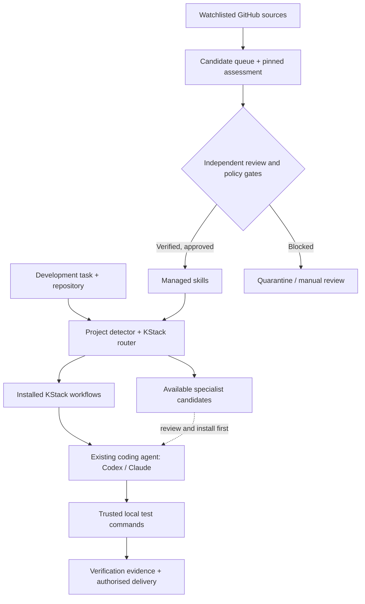

<div align="center">

# kstack

**A reproducible, evidence-driven developer stack for coding agents.**

Use the right skills for the right task. Prove what works. Improve the stack without trusting every new tool on the internet.

**Local-first · Python standard library · Portable skill instructions · Version-pinned reviews · No hosted CI required**

[Start](#quick-start) · [Capabilities](#what-works-today) · [Command reference](#commands) · [Evolution](#discovery-and-evolution) · [Security](docs/SECURITY.md) · [Remaining work](CODEX_TODO.md)

</div>

> **Status: v0.2 development preview.** The source contains a functional CLI, project detection, recommended skill routing, host-specific skill installation, reviewed local multi-file skill-package copying, pinned GitHub discovery, evaluation gates, rollback, local verification and weekly-runner entry points. **It is not an autonomous AI runtime.** Real Codex/Claude invocation, third-party skill effectiveness, live GitHub discovery, secure candidate execution and a deployed recurring schedule are **not yet independently accepted**. See [status matrix](IMPLEMENTATION_STATUS.md).

## Why it exists

Coding agents are more useful when they have good engineering guidance, but copy-pasting dozens of instructions into every chat is a maintenance problem. KStack keeps general skills discoverable, chooses the smallest appropriate workflow, and separates actual evidence from model-generated assertions. It delegates implementation to an existing coding host; KStack itself does **not** spawn Codex, Claude or paid models.



## Quick start

Requires **Python 3.10+**, Git for reviewed local external packages, and an existing coding-agent host if you want an agent to actually use skills. No runtime Python dependencies are required.

```bash
git clone https://github.com/Itskorrah/kstack.git
cd kstack
python scripts/kstack.py doctor                 # checks source, not host invocation
python scripts/kstack.py list
python scripts/kstack.py inspect-project --project .
python scripts/kstack.py route "Improve the Python code and test it" --project .
```

Install the **bundled KStack skills** into Codex or Claude Code:

```bash
python scripts/kstack.py install --host codex --scope global --dry-run
python scripts/kstack.py install --host codex --scope global
python scripts/kstack.py doctor --host codex --scope global
python scripts/kstack.py host-status --host codex --scope global

# Or use --host claude. To install into one repository:
python scripts/kstack.py install --host codex --scope project --project /path/to/app
```

The installer preserves unmanaged files and refuses to adopt or overwrite them, even when their bytes match a bundled skill. Managed host updates use a recoverable file transaction and retain the previous generation for `rollback-install`. If a process stops during an update, run `recover-install` before other host mutations. A successful `doctor` means the installed files match KStack's hashes; it **does not prove Codex or Claude loaded them**. Host invocation remains a separate acceptance requirement. The `host-status` command reports binary presence and file integrity without inventing model-session acceptance.

State writes use an OS advisory lock with persistent owner metadata. Use `lock-status` to inspect it; `recover-lock --owner-pid PID` only clears verified stale ownership after the process has stopped. A legacy `.write-lock` directory also blocks writes until explicitly inspected and recovered.

### Bootstrap a repository

```bash
python scripts/kstack.py inspect-project --project /path/to/app
python scripts/kstack.py bootstrap --project /path/to/app --instructions  # preview only
python scripts/kstack.py bootstrap --project /path/to/app --instructions --apply
python scripts/kstack.py route "Refactor the user interface" --project /path/to/app
```

Bootstrap generates `kstack.json` only if absent; with `--instructions`, it adds managed sections to `AGENTS.md` and `CLAUDE.md`, preserving existing content and refusing malformed markers. It does not install all external tools, grant permissions, install a background daemon or alter existing project tests.

Project inspection recognises declared npm, pnpm and Cargo workspace roots and reports per-root technology and verification suggestions. Suggestions are not copied into trusted commands automatically. In configuration version 2, a project owner can review and explicitly add per-workspace `verification_targets`; KStack runs each target's argument-list commands from that target directory only after `verify-project --run` is requested.

A simple project configuration looks like:

```json
{
  "version": 1,
  "profile": "python",
  "skill_preferences": [],
  "verification_commands": [["python", "-m", "unittest", "discover", "-s", "tests", "-v"]],
  "delivery": {"verify_before_merge": true}
}
```

For a monorepo, configuration version 2 can hold reviewed commands per workspace:

```json
{
  "version": 2,
  "profile": "monorepo",
  "verification_commands": [],
  "verification_targets": [
    {"path": "apps/web", "commands": [["npm", "test"]]},
    {"path": "packages/api", "commands": [["python", "-m", "unittest", "discover", "-s", "tests"]]}
  ]
}
```

**Only put commands you trust in `verification_commands`.** KStack runs them as subprocesses only when you explicitly supply `--run`; this command runner is **not a security sandbox**, and should never be pointed at unreviewed upstream instructions.

```bash
python scripts/kstack.py verify-project --project /path/to/app     # preview
python scripts/kstack.py verify-project --project /path/to/app --run --timeout 120
python scripts/kstack.py evidence
```

## What works today

| Capability | Implemented | Real-world acceptance |
|---|---|---|
| Bundled skills: router, audit, verify, ship, setup, maintenance, project | Yes | File and format checks; live host invocation pending |
| Local project detection and bootstrapping | Yes | Deterministic fixtures tested |
| Declared monorepo roots and per-root verification targets | Yes | Synthetic npm workspace tested; suggestions require owner review |
| Risk-aware, host-aware task routing | Yes | Installed file and capability status tested; no semantic model reasoning or host invocation |
| Host skill file install / uninstall / integrity doctor | Yes | Filesystem tests; native Codex/Claude pending |
| Manually reviewed local external package copying and sibling dependencies | Yes | Clean Git SHA, version graph, full-file hash and copy tests; upstream execution pending |
| Read-only GitHub discovery and source pinning | Yes | Mocked API tests; live network pending |
| Candidate screening, evidence-gated auto-promotion | Yes | Deterministic review/policy tests; independent host reviewer still external |
| Crash-recoverable state and host skill generations with rollback | Yes | Simulated recovery and rollback tests; interrupted host writes need recovery, not a distributed transaction |
| Approved-skill lock export and inspection | Yes | Hash and source validation tested; full multi-machine import pending |
| Explicit local verification command runner | Yes | Real subprocess pass/fail and failure-path tests |
| Hash-linked local evidence and outcome recording | Yes | Integrity tests; not signed provenance or causal learning |
| Weekly maintenance runner and candidate queue | Yes | Local schedule logic tested; no OS task installed |
| Real BreakSwarm / RepoPilot integrations | No | Catalogue metadata only |
| GitHub delivery preflight | Yes | Bound to clean Git revision and local successful test evidence; no write adapter |
| Runtime multi-agent coordination / automatic model selection | No | Delegated to supported coding hosts |
| Live authenticated agent-provider integration | No | Awaiting host access and API acceptance |

## Commands

| Command | Action / safety boundary |
|---|---|
| `list` | Enumerate bundled, promoted and referenced external skills |
| `inspect-project --project PATH` | Read known project manifests; no execution |
| `bootstrap --project PATH [--instructions] [--apply]` | Preview or add a minimal project profile/instruction blocks |
| `route "TASK" [--project PATH] [--host codex\|claude --scope project\|global]` | Recommend workflows and report installed-file status; does not claim host invocation |
| `install / uninstall --host codex\|claude` | Synchronise or remove only KStack-owned skill files |
| `recover-install --host ... [--scope ...]` | Recover an interrupted host file transaction before further host mutations |
| `rollback-install --host ... [--scope ...]` | Restore the retained prior KStack-managed host generation when its files are unchanged |
| `doctor [--host ...]` | Check local integrity; missing host install returns failure |
| `host-status --host ...` | Report host binary and skill file status, not live invocation |
| `external-install --source PATH --skill-dir PATH --commit SHA ...` | Preview a clean, pinned Git checkout skill package; actual copy requires `--apply --reviewed`; executable files also require `--allow-code` |
| `external-list --host ...` | Detect installed package tampering and missing files |
| `external-uninstall --host ... --name SKILL [--dry-run]` | Remove only hash-matching files recorded for one external skill; refuses installed dependents and preserves user edits |
| `lock-status` / `recover-lock --owner-pid PID` | Inspect or explicitly recover a verified stale state lock |
| `scan` | Read watchlisted GitHub repositories; record changed commits |
| `assess ID` | Analyse exact pinned candidate `SKILL.md`, with defensive screening |
| `queue` | Display pending, assessed and quarantined revisions |
| `promote ID --review FILE --autonomous` | Apply policy-gated approval to a pinned single-file Markdown skill |
| `maintenance [--apply --reviews DIR]` | Discover/assess and optionally promote independently reviewed candidates |
| `rollback SNAPSHOT` | Restore prior approved manifest using an undo journal; reinstall host skills afterwards |
| `export-lock --file FILE [--apply]` | Preview or export approved immutable skill references |
| `inspect-lock --file FILE` | Validate lockfile references and locally cached skill hashes |
| `verify-project --project PATH [--run]` | Preview or run only trusted project-declared commands |
| `evidence` | Verify append-only journal hash chain (not a cryptographic signature) |
| `delivery-plan --project PATH --repository OWNER/REPO [--authorised]` | Check fresh clean Git revision, locally recorded passing verification and task authority; **never pushes or merges** |
| `record-outcome --file FILE` / `outcomes` | Record and aggregate clearly self-reported engineering outcomes |
| `schedule-status` | Show whether a weekly maintenance run is due |

Use `python scripts/kstack.py COMMAND --help` for exact arguments. The installed package also exposes `kstack` and `kstack-weekly` entry points.

## Reviewed external packages

KStack does not automatically vendor Evolve, pstack, Superpowers or other third-party ecosystems. Their entries in `data/integrations.json` are references, **not proof of installation**. To import a skill from a separately reviewed, clean local Git checkout:

```bash
# Obtain and independently review the upstream checkout first.
git -C /path/to/evolve rev-parse HEAD
python scripts/kstack.py external-install \
  --host codex --scope project --project /path/to/app \
  --source /path/to/evolve --skill-dir skills/evolve \
  --commit FULL_40_CHARACTER_COMMIT

# After reviewing source, licence, included files, permissions and compatibility:
python scripts/kstack.py external-install \
  --host codex --scope project --project /path/to/app \
  --source /path/to/evolve --skill-dir skills/evolve \
  --commit FULL_40_CHARACTER_COMMIT --apply --reviewed --allow-code
```

Replace the example `--skill-dir` with the actual skill directory in the chosen checkout; the example path may vary between upstream revisions. The installer copies bytes only; it **does not execute the repository's install scripts or validate the agent's runtime behaviour**. `--allow-code` is a separate explicit risk decision for packages with scripts/assets. KStack's optional `kstack-package.json` format 1 is a local extension for declaring sibling skills, SemVer dependencies and provided capabilities; it is not an upstream package standard. Unsupported or undeclared external dependencies may still leave a skill unusable until separately integrated and host-tested.

Use `external-uninstall --host codex --scope project --project /path/to/app --name evolve --dry-run` to preview removal, then omit `--dry-run` to remove the hash-matching files. Remove installed dependents first. Locally edited or unrelated files are preserved, and an interrupted removal can be recovered with `recover-install`.

```json
{
  "format": 1,
  "skills": [
    {
      "name": "coordinator",
      "path": "skills/coordinator",
      "version": "1.0.0",
      "dependencies": [{"name": "audit", "specifier": ">=1.0.0,<2.0.0"}],
      "provides": ["orchestration.example"]
    },
    {"name": "audit", "path": "skills/audit", "version": "1.2.0", "provides": ["review.audit"]}
  ]
}
```

## Discovery and evolution

The GitHub scanner reads only watched repositories from `data/watchlist.json`. For each discovered `SKILL.md`, KStack resolves an immutable commit, saves candidate metadata and preserves bounded revision history. It uses fair round-robin candidate selection rather than filling the scan exclusively from a large first repository.

```bash
python scripts/kstack.py scan                  # network reads; may require GITHUB_TOKEN
python scripts/kstack.py maintenance           # assess discovered candidates
python scripts/kstack.py queue
python scripts/kstack.py status
```

Promotion requires a reviewed pinned source, no screening blockers, an allowlisted publisher, a single-file Markdown package, an independently attested isolated rehearsal, and the configured quality/security thresholds. **A submitted review JSON is not independently authenticated by KStack**; this is an unresolved provenance limitation. KStack never executes candidate scripts during discovery, assessment or promotion.

Use the [review contract](docs/REVIEW_SCHEMA.md) and [maintenance procedures](docs/MAINTENANCE.md). High autonomy is permission-bounded; it does not imply authority to disable controls or access private project data.

### Scheduled maintenance

```bash
python scripts/maintenance_runner.py                      # report only; no network
python scripts/maintenance_runner.py --run                # one bounded GitHub discovery run
python scripts/kstack.py schedule-status
```

The installed wheel exposes `kstack-weekly`. Arrange invocation using **your own approved external scheduler** (macOS launchd, Windows Task Scheduler, cron or another service). KStack does not register a task or keep a background process alive. A successful weekly scan is not an independent quality evaluation. The separate [ChatGPT intelligence task prompt](docs/SCHEDULER_PROMPT.md) can perform research/reporting but does not inherit your local computer or coding-agent permissions.

## Security and operational limits

- Candidate skills and other GitHub content are **untrusted instructions**, even if their publisher is allowlisted. Source pinning and screening are necessary but not sufficient safeguards.
- `external-install` requires clean local Git state, exact commit, manually asserted review, code permission for non-documentation files and hash-checked copies. It refuses to adopt unowned files and rejects POSIX/Windows rooted package paths. It is **not** automatic third-party supply-chain verification.
- KStack's local test runner is only for trusted project commands, not arbitrary downloaded code. Local evaluation requires a separately isolated environment.
- `GITHUB_TOKEN` is read from the process environment for API requests and never persisted by the CLI. Never paste credentials in public reports.
- Skill state under `~/.kstack/` is local, not encrypted. State changes use a kernel-released advisory lock. Core and external host-file changes use a write-ahead journal, per-file atomic replacement and retained rollback snapshots; a crash can expose a partial generation until `recover-install` completes. These mechanisms do not secure data against a malicious local account.
- No real Codex or Claude Code session has been run in this environment. A host's installed skill files and a valid plugin manifest are **not** proof of actual implicit invocation.
- The repository is public: do not commit secrets, private user files or unreviewed external skill contents.

Read the [security model](docs/SECURITY.md), [architecture](docs/ARCHITECTURE.md) and [acceptance plan](docs/ACCEPTANCE.md).

## Develop and contribute

```bash
PYTHONPATH=src python -m unittest discover -s tests -v
python -m compileall -q src/kstack scripts
python scripts/kstack.py doctor
python scripts/kstack.py schedule-status
python scripts/kstack.py lock-status
python scripts/kstack.py route "Fix a workspace regression" --project /path/to/app --host codex --scope project
```

GitHub Actions are **not required**, and KStack's local verification does not claim any hosted CI results. To preview delivery safety after verified tests on a clean Git working tree, use `kstack delivery-plan --project /path/to/app --repository OWNER/REPO --authorised`; this does not create branches or merge anything. Source changes should include meaningful tests and precise capability claims. Do not add a second orchestrator by default, use unverifiable scoring as security evidence, or copy external code without a licence review.

See [implementation status](IMPLEMENTATION_STATUS.md), [known gaps and Codex handover](CODEX_TODO.md) and [changelog](CHANGELOG.md).

## Licence

KStack's own code and bundled skills are MIT-licensed. Third-party content remains under its respective licences; references and package installers do not transfer ownership or licence rights.
