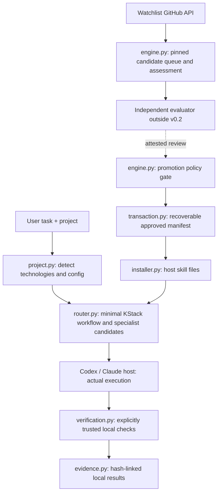

# Architecture, contracts and decisions

**Current version:** v0.2 development preview. KStack is a local-first control plane for an existing coding host, not a new autonomous coding model runtime.



## Modules and boundaries

| Module | Contract | Must not claim |
|---|---|---|
| `cli.py` | Explicit state-mutating versus read-only commands; JSON output and error exit codes | Every command is safe to run against untrusted local projects |
| `project.py` | Read known root manifests; safe `kstack.json` bootstrap and managed instruction blocks | Automatic full monorepo understanding or guaranteed host use |
| `router.py` | Deterministic task/risk/context recommendations, distinguishes bundled from candidate external skills | True semantic quality or actual model invocation |
| `external.py` | Import reviewed, pinned local Git package data into supported host skill folder; no execution | Full safe supplier identity or functioning multi-skill integration |
| `github_api.py` | Read-only watchlisted GitHub API operations, immutable SHA | GitHub write authority or live API acceptance |
| `engine.py` | Candidate state, immutable content, review thresholds, promotion and rollback | Independently performed and authenticated external model reviews |
| `queue.py` | Descriptive priority view of assessed/unassessed candidates | Proof candidate will improve developer work |
| `state.py` | Atomic JSON file writes, cooperative write lock | Distributed transaction or protection against local user tampering |
| `transaction.py` | Write-ahead undo journal for active/history/snapshot generation | Atomicity across all host installations |
| `installer.py` | Managed, conflict-aware basic skills installation and file integrity | A coding host loaded or obeyed the installed skill |
| `hosts.py` | Host executable visibility, local installation status | Authenticated host session acceptance |
| `portfolio.py` | Export approved immutable source records; inspect against cached objects | Automatically trusted cross-machine import or signed provenance |
| `verification.py` | Bounded explicit subprocess tests and current local Git snapshot, declared by trusted project owner | Sandbox safety or broader test coverage without configured commands |
| `delivery.py` | Advisory preflight binding authorised delivery to a clean Git commit and fresh successful test evidence | GitHub branch/PR creation, merge or authenticated remote-state checks |
| `evidence.py` | Hash-linked local journal and corruption detection | Signed independent evaluation evidence |
| `feedback.py` | Honest self-reported outcome metadata and counts | Causal effectiveness improvements |
| `scheduler.py`, `weekly.py` | External-scheduler-ready, bounded weekly API discovery | Persistent daemon or installed recurring OS task |

## State directory

Personal state defaults to `~/.kstack/` (override with `--state`):

```text
active.json                         # currently approved external SKILL.md objects
history.json                        # promotion/rollback generations
snapshots/000001.json               # previous generation
pending-transaction.json            # transient undo journal; blocks unsafe writes
.write-lock/owner.json              # transient cooperative mutation lock
objects/<sha256>.md                 # pinned approved/source Markdown
candidates.json                     # current source revision per candidate identity
candidate-revisions.json            # bounded prior-revision metadata
last-discovery.json                 # scan observation and errors
maintenance-schedule.json           # local weekly attempt status
outcomes.json                       # user-reported, explicitly unverified observations
evidence.json                       # hash-linked local run/event metadata
```

No state is automatically uploaded into the public repository. JSON generation updates are crash-recoverable through an undo journal; the evidence log and other operations are not part of one atomic database transaction. State synchronisation across machines and signed provenance remain future requirements.

## Skill integration boundaries

Bundled KStack skills live under `skills/` and are mirrored into `src/kstack/bundled/skills` for wheel distribution. `installer.py` owns only the files declared in `.kstack-managed.json`; `external.py` owns manually reviewed source packages under `.kstack-external-managed.json`. Neither installer should overwrite a file owned by the other or by a user.

External integration catalogue entries are metadata, not installed tools. No upstream scripts execute during installation. Full packages with code require deliberate trust review and an explicit copy permission. The actual agent host determines whether skill discovery, scripts and provider integrations are available.

## Promotion state machine

```text
upstream source -> pinned commit -> discovered
        -> assessed or quarantined
        -> genuine independent sandbox review (outside v0.2)
        -> policy check -> immutable active object
        -> undo-journal state generation -> installed host file set
        -> real host acceptance (outside v0.2)
```

An upstream revision is a new candidate; it does not replace an approved revision without a new review. The reviewed source hash and actual approval outcome belong together. Current review JSON attestations are statements, not independently authenticated evidence.

## Non-goals

- Replacing Codex or Claude Code's own tools, instruction hierarchy and model selection.
- Executing unreviewed downloaded shell scripts or creating a privileged always-on agent.
- Running GitHub Actions when account minutes are unavailable.
- Pretending local file checks equal real Windows/macOS/agent acceptance.
- Building a GUI before the CLI and host integrations are dependable.

See `docs/SECURITY.md`, `docs/ACCEPTANCE.md`, `IMPLEMENTATION_STATUS.md` and `CODEX_TODO.md`.
