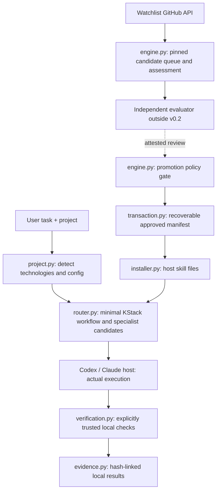

# Architecture, contracts and decisions

**Current version:** v0.2 development preview. KStack is a local-first control plane for an existing coding host, not a new autonomous coding model runtime.



## Modules and boundaries

| Module | Contract | Must not claim |
|---|---|---|
| `cli.py` | Explicit state-mutating versus read-only commands; JSON output and error exit codes | Every command is safe to run against untrusted local projects |
| `project.py` | Read known root manifests and declared npm/pnpm/Cargo workspaces; safe `kstack.json` bootstrap, owner-reviewed workspace verification suggestions and managed instruction blocks | Automatic full monorepo understanding or guaranteed host use |
| `router.py` | Deterministic task/risk/context recommendations; distinguishes available workflows, installed files and candidate external skills | True semantic quality or actual model invocation |
| `external.py` | Import and remove reviewed, pinned local Git package data; resolve KStack-declared sibling dependencies and capabilities; no execution | Full safe supplier identity or functioning multi-skill integration |
| `github_api.py` | Read-only watchlisted GitHub API operations, immutable SHA | GitHub write authority or live API acceptance |
| `engine.py` | Candidate state, immutable content, review thresholds, promotion and rollback | Independently performed and authenticated external model reviews |
| `queue.py` | Descriptive priority view of assessed/unassessed candidates | Proof candidate will improve developer work |
| `state.py` | Atomic JSON file writes and OS-released advisory write lock with owner metadata | Distributed transaction or protection against local user tampering |
| `transaction.py` | Write-ahead state journal; staged host file journal, rollback snapshots and interrupted-transaction recovery | Simultaneous atomic visibility of a multi-file generation or atomicity across hosts |
| `installer.py` | Managed, conflict-aware host skill generations, integrity checks, explicit recovery and retained rollback | A coding host loaded or obeyed the installed skill |
| `hosts.py` | Host executable visibility, local installation status | Authenticated host session acceptance |
| `portfolio.py` | Export approved immutable source records; inspect against cached objects | Automatically trusted cross-machine import or signed provenance |
| `verification.py` | Bounded explicit subprocess tests, before/after Git snapshots and a digest of Git-visible changed-file contents | Sandbox safety, ignored-file integrity or broader test coverage without configured commands |
| `delivery.py` | Advisory preflight binding authorised delivery to a clean Git commit and fresh successful test evidence | GitHub branch/PR creation, merge or authenticated remote-state checks |
| `evidence.py` | Hash-linked local journal and corruption detection | Signed independent evaluation evidence |
| `feedback.py` | Honest self-reported outcome metadata and counts | Causal effectiveness improvements |
| `scheduler.py`, `weekly.py` | External-scheduler-ready, bounded weekly API discovery | Persistent daemon or installed recurring OS task |

## State directory

Personal state defaults to `~/.kstack/` (override with `--state`):

```text
active.json                         # currently approved external SKILL.md objects
history.json                        # promotion/rollback generations
snapshots/000001.json               # previous generation
pending-transaction.json            # transient undo journal; blocks unsafe writes
.kstack-write.lock                    # persistent owner record + kernel-released lock
objects/<sha256>.md                 # pinned approved/source Markdown
candidates.json                     # current source revision per candidate identity
candidate-revisions.json            # bounded prior-revision metadata
last-discovery.json                 # scan observation and errors
maintenance-schedule.json           # local weekly attempt status
outcomes.json                       # user-reported, explicitly unverified observations
evidence.json                       # hash-linked local run/event metadata
```

Each host skill folder also uses `.kstack-host.lock` to serialize core and external installers, `.kstack-host-transaction.json` plus a private staging directory while a file transaction is pending, and `.kstack-generations/<id>/` for retained core-skill rollback data. The journal is written before replacement; KStack replaces managed files one at a time and writes the managed manifest last. If interrupted, `recover-install` validates paths and hashes and restores the old generation. Until recovery, host readers could see a partial file set.

No state is automatically uploaded into the public repository. JSON generation updates are crash-recoverable through an undo journal; the evidence log and other operations are not part of one atomic database transaction. State synchronisation across machines and signed provenance remain future requirements.

## Skill integration boundaries

Bundled KStack skills live under `skills/` and are mirrored into `src/kstack/bundled/skills` for wheel distribution. `installer.py` owns only files declared in `.kstack-managed.json`; `external.py` owns manually reviewed source packages under `.kstack-external-managed.json`. Both use the same host lock and transaction journal. Neither installer may adopt or overwrite a file owned by the other or by a user, even if its bytes happen to match.

External integration catalogue entries are metadata, not installed tools. KStack's optional `kstack-package.json` format 1 extension declares sibling skills with `name`, `path`, `version`, optional versioned `dependencies`, and optional `provides` capability IDs. Resolution checks missing/incompatible/cyclic dependencies, duplicate names or capabilities, path escapes and tracked-file hashes before any write. This format is a KStack extension, not an upstream standard. No upstream scripts execute during installation. Full packages with code require deliberate trust review and an explicit copy permission. The actual agent host determines whether skill discovery, scripts and provider integrations are available.

Project inspection recognises declared npm, pnpm and Cargo workspace patterns within bounded limits and reports per-target technologies. Verification suggestions are advisory. Config v2 can explicitly store `verification_targets`, each containing a project-relative `path` and argument-list `commands`; the owner must review these commands before `verify-project --run` executes them from the target directory. Bootstrap never copies inferred commands into trusted configuration.

For Git projects, verification records snapshots before and after the configured commands. The snapshot binds the commit, branch, cleanliness, and a SHA-256 fingerprint of the Git index, tracked changes, and non-ignored untracked files. Only the digest is stored; raw diffs and test output are not. If the Git state changes or a complete fingerprint is unavailable, passing commands still produce an incomplete result. This does not detect changes to ignored files or transient edits that are fully restored before the final snapshot; modified submodules and special files are treated as uninspectable. Non-Git project behavior remains supported, but those checks have no revision binding.

Routing accepts a host and scope to inspect installed bundled workflow files and external capability manifests. Results distinguish `available-not-installed` from `installed-files-unverified`; neither establishes host invocation.

## Promotion state machine

```text
upstream source -> pinned commit -> discovered
        -> assessed or quarantined
        -> genuine independent sandbox review (outside v0.2)
        -> policy check -> immutable active object
        -> undo-journal state generation -> installed host file set
        -> real host acceptance (outside v0.2)
```

An upstream revision is a new candidate; it does not replace an approved revision without a new review. The reviewed source hash and actual approval outcome belong together. Current review JSON attestations are statements, not independently authenticated evidence.

## Non-goals

- Replacing Codex or Claude Code's own tools, instruction hierarchy and model selection.
- Executing unreviewed downloaded shell scripts or creating a privileged always-on agent.
- Running GitHub Actions when account minutes are unavailable.
- Pretending local file checks equal real Windows/macOS/agent acceptance.
- Building a GUI before the CLI and host integrations are dependable.

See `docs/SECURITY.md`, `docs/ACCEPTANCE.md`, `IMPLEMENTATION_STATUS.md` and `CODEX_TODO.md`.
